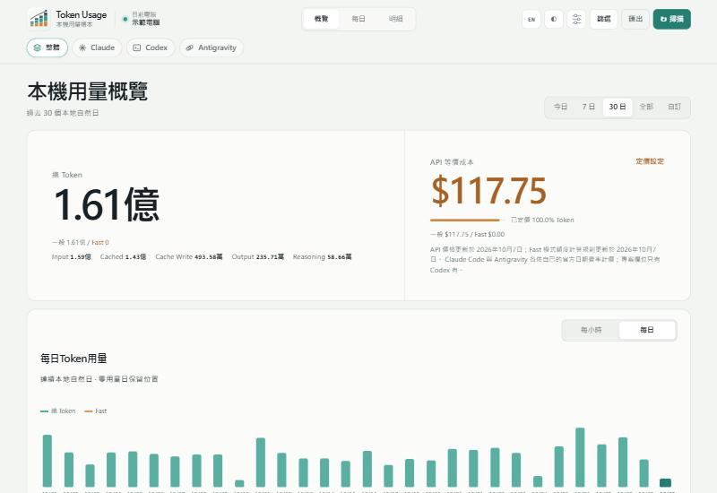
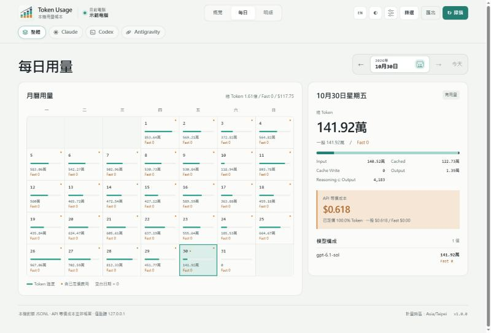

# Token Usage

[中文](README.md) | **English**

Local token usage and API-equivalent cost for **Codex**, **Claude Code** and **Antigravity**, on your own machine. All three sources live in one local dashboard: view them combined or switch to a single source. Nothing leaves the computer.



## Features

- **Source switcher**: icon buttons in the header switch between **All · Claude · Codex · Antigravity**. The choice is remembered in the browser; `?provider=claude` in the URL opens a source directly.
- **Overview**: today, 7 days, 30 days, all time, or a custom range to the minute. Total tokens with Input / Cached / Cache Write / Output / Reasoning, API-equivalent cost with pricing coverage, and hourly and daily trends.
- **Daily**: calendar heat map; pick a day for its model mix and cost.
- **Details**: group by model, source, agent, project or thread; session list and task tree; session search.
- **Export**: CSV or JSON for the current source and filters.
- **Limits**: each tool's 5-hour and weekly usage limits per account, with percentage used, reset time, past windows, and the tokens and API-equivalent cost of each window; see "Limits" below.
- **Software updates**: checks GitHub for new releases and shows a notice at the top of the page. Download and update verifies, backs up, replaces the program and restarts it; portable copies update in place too.
- Traditional Chinese / English, light / dark theme, type size and density settings.



## What is counted

| Source | Local data read | Recorded |
|---|---|---|
| Codex | JSONL under `sessions/` and `archived_sessions/` in `CODEX_HOME` (default `~/.codex`), including rollouts Codex compressed to `.jsonl.zst`, plus paths and titles from the Codex state database | Token categories, model, source, project, thread, agent, Fast mode |
| Claude Code | JSONL under `~/.claude/projects` and `~/.config/claude/projects` (including subagents and SSH sessions synced locally) | Token categories, model, 5-minute / 1-hour cache writes, thinking tokens, speed and inference region |
| Antigravity | `~/.gemini/antigravity*/brain/*/.system_generated/logs/transcript.jsonl` and the matching `conversations/*.db` | Token categories, model, thinking tokens, model selections |

**All** is the sum of the three sources. A model reported by both Claude Code and Antigravity (for example `claude-opus-5-5`) is merged into one row when grouping by model.

Replies, reasoning text and tool output are never stored. The Claude Code and Antigravity ledgers keep only token counts, models, times and hashed identifiers; Codex also keeps the conversation titles and project paths that Codex itself records, and a title is usually the first prompt. When Antigravity has no native counts, its text is read to estimate tokens from character counts, and is not stored either. Usage counting never reads credentials or real bills; what the Limits page reads about accounts is described under "Limits".

Deduplication, attribution and pricing rules are described in [Accounting and pricing](docs/accounting.md) (Chinese).

## Quick start

### 1. Build

Requires Go 1.26 or later.

```bash
go build -o token-usage.exe ./cmd/token-usage
```

Or run `scripts/build.ps1` (Windows) / `scripts/build.sh` (Linux, macOS); both run the full test suite and write binaries for every platform to `dist/`.

### 2. Choose where data lives

Create a `data` folder beside the executable to run in **portable mode**: all three ledgers and the limit records are kept in that folder, so the program and its data can sit together in OneDrive or another synced folder. Without a `data` folder, data goes to the per-user application data folder (see "Where data lives").

### 3. Install and start

```bash
token-usage install
```

This runs a full scan of Codex records, registers a per-user background start at login and starts the service, which then scans Claude Code and Antigravity. No administrator rights are needed. In portable mode the program runs where it is; otherwise it is copied into your user folder.

### 4. Open

```bash
token-usage
```

Or open **http://127.0.0.1:43189/**.

If another program already uses port 43189 (or Windows has reserved it), the program switches to the next free port, saves it in the settings and prints the new address. If the service fails to start, the last lines of its log `daemon.log` are shown; when opened by double-click, the window stays open until you press Enter.

## Commands

```text
token-usage                         Open the dashboard
token-usage summary --since 7d      Codex summary for the last 7 days (--json / --csv)
token-usage scan                    Incrementally scan all three sources
token-usage scan --rebuild          Rebuild Codex statistics from existing JSONL
token-usage serve                   Run the local service in the foreground
token-usage doctor                  Check Codex paths, sources and service state
token-usage config add-home PATH    Add another CODEX_HOME
token-usage uninstall               Stop the service, remove the login start (and the program in standard mode); keep ledgers
token-usage uninstall --purge       Standard mode: also delete the whole service folder (all three ledgers and the limit records)
```

The background service scans once at start. After that, Codex files are checked for changes every 30 seconds and scanned only when they change, with a fallback scan every 10 minutes; Claude Code and Antigravity are scanned every 10 minutes. The **Scan** button scans all three immediately.

## Uninstall

On Windows, an installed copy is listed under Settings > Apps > Installed apps; choose Uninstall and confirm. It stops the service and removes the start at login (and the program in standard mode); data is kept. The command-line steps follow.

Installing does not add the program to `PATH`, so run it by its full path. Any copy of the `token-usage` executable works, such as the one you just downloaded; it finds the installed service for the mode it runs in.

### Standard mode

Windows (PowerShell):

```powershell
& "$env:LOCALAPPDATA\Programs\token-usage\token-usage.exe" uninstall
```

macOS:

```bash
~/Library/Application\ Support/token-usage/bin/token-usage uninstall
```

Linux:

```bash
~/.local/bin/token-usage uninstall
```

This stops the service, removes the start at sign-in and deletes the installed program; your data stays in the service folder (see "Where data lives"). To delete the data as well, add `--purge`: it deletes the whole service folder, including all three ledgers, the limit records and settings, and cannot be undone from the tool.

### Portable mode

```powershell
& "<folder of the program>\token-usage.exe" uninstall
```

This only stops the service and removes the start at sign-in; the program and the `data` folder stay, and `--purge` is refused. To remove everything, then delete `token-usage.exe` and the `data` folder yourself; copy `data` elsewhere first if you want to keep your usage records.

### What is deleted and kept

| | Standard mode | Standard mode with `--purge` | Portable mode |
|---|---|---|---|
| Background service, start at sign-in | Removed | Removed | Removed |
| Program | Deleted | Deleted | Kept |
| Ledgers, limit records and settings | Kept | Deleted | Kept |

## Where data lives

Everything lives in one service folder: the service's own files at the top, and one subfolder per ledger.

```text
service folder/
├─ config.json             settings
├─ daemon.log              service log
├─ token-usage-start.vbs   starts the service at sign-in (Windows)
├─ backups/                backups taken before a software update
├─ codex/                  Codex statistics (usage.sqlite)
├─ claude/                 Claude Code ledger (usage.sqlite)
├─ antigravity/            Antigravity ledger (usage.sqlite)
└─ limits/                 Limit records (limits.sqlite)
```

### Portable mode (a `data` folder beside the executable)

The service folder is the `data` folder beside the executable:

```text
TokenUsage/
├─ token-usage.exe
└─ data/
```

When the folder is in OneDrive:

- Right-click the `data` folder and choose "Always keep on this device" so the files never become cloud-only.
- Run one copy of `data` on one computer at a time.
- The ledgers are SQLite databases with `-wal` and `-shm` side files while running. The cloud copy can lag by a few minutes; before using it on another computer, stop the service on the first one and let sync finish.

### Standard mode

| System | Program | Service folder |
|---|---|---|
| Windows | `%LOCALAPPDATA%\Programs\token-usage\token-usage.exe` | `%LOCALAPPDATA%\token-usage\` |
| macOS | `~/Library/Application Support/token-usage/bin/token-usage` | `~/Library/Application Support/token-usage/` |
| Linux | `~/.local/bin/token-usage` | `~/.local/share/token-usage/` |

All three ledgers are append-only: once usage is recorded it stays, even after the source JSONL is cleaned up or moved. When a source correction changes a record, the previous value is kept in the ledger's revision table.

### Settings and environment variables

`config.json`:

```json
{
  "listen_address": "127.0.0.1",
  "port": 43189,
  "scan_interval_seconds": 600
}
```

| Variable | Purpose |
|---|---|
| `CODEX_HOME` | Codex folder (default `~/.codex`) |
| `TOKEN_USAGE_HOME` | Service folder; must be a dedicated empty folder |
| `TOKEN_USAGE_TIMEZONE` | Accounting time zone used when the statistics database is first created, e.g. `Asia/Taipei` |
| `TOKEN_USAGE_LANG` | CLI language: `en` or `zh-TW` |
| `CLAUDE_CONFIG_DIR` | Claude Code config folder(s), comma-separated |
| `CLAUDE_TRACKER_DATA` | Claude Code ledger folder |
| `ANTIGRAVITY_TRACKER_HOME` | Antigravity folder (default `~/.gemini`) |
| `ANTIGRAVITY_TRACKER_DATA` | Antigravity ledger folder |
| `LIMITS_TRACKER_DATA` | Limit records folder |

## Privacy and security

- The service binds to `127.0.0.1` only and refuses any other address; mutating API calls must come from a local origin.
- The page loads no external resources and ships a strict Content-Security-Policy.
- No usage data is uploaded, no telemetry.
- By default the only network access is **Software updates**: it asks GitHub for the latest version number every 6 hours (you can turn this off under Software updates in the page footer). A new version is downloaded only when you choose Download and update; it is verified against the release SHA256SUMS, the program, all three ledgers and the limit records are backed up, and the previous version is restored automatically if the new one does not start. Downloads go to the system temporary folder by default and are deleted once installed; once the update has finished (the new version is running, or the old one was restored) the program and ledger backups are deleted too, and a failed update keeps them for manual recovery.
- Anthropic's official endpoints are contacted only after you turn on Claude Code limits (see "Limits"); while it is off, nothing is sent.
- Antigravity limits are read only from Antigravity's own language server on `127.0.0.1`; nothing goes off the machine.
- Prices are built into the program; nothing is fetched at runtime.

## What the cost means

Amounts are equivalents at each vendor's public **Standard API prices**. They are **not** your subscription charges or bill:

- Codex uses the built-in OpenAI price table; usage explicitly marked Fast is weighted by the Codex quota multiplier.
- Claude Code uses Anthropic's official dated rates with separate 5-minute and 1-hour cache-write prices; fast mode and the US inference region use the official multipliers.
- Antigravity uses dated rates per model; long-context Gemini 3.1 Pro requests use the higher tier.

Models or dates without a verified rate are shown as unpriced. Their tokens still count, and they are never treated as free. The **Pricing** dialog has one tab each for Codex, Claude Code and Antigravity, listing built-in rates and unpriced models. Codex models can take an alias or custom rate; Claude Code and Antigravity take custom rates with a start date.

## Limits

The **Limits** page shows each tool's 5-hour and weekly usage limits per account: percentage used, reset time, past windows, and each window's total tokens and API-equivalent cost (priced as on the statistics pages; not a bill).

- Codex tokens and cost count only that account's own usage: every token count is written on the same line as the limit snapshot of that moment, which names the account.
- When a limit is reset before its window ends (an official reset or a reset credit), the old window ends at the actual reset, is marked "Reset early", and its tokens and cost stop there.
- Current limits follow each account's most recent reading: a limit past its reset time reads 0% until the next reading, and goes only once a later reading no longer has it. An account no longer in use can be removed with "Remove" from the current view and from "All"'s current state; its history is kept, and it returns on its own when a new reading of it arrives.

The data is kept in `limits.sqlite` (see "Where data lives") and is backed up with the ledgers before a software update. With a single source selected, each model group's 5-hour and weekly limits sit side by side; with "All" selected, a line chart shows every tool's usage over 1, 7 or 30 days or a custom range, with each tool's current state below. Buttons switch between 5-hour and weekly.

### Sources

- **Codex** (always on): reads the `rate_limits` snapshots Codex writes with each token count in its rollout logs (`sessions/` and `archived_sessions/`, including `.jsonl.zst`): percentage used, window length (300 or 10080 minutes), reset time and plan. Collected every minute. The signed-in account is identified from the identity claims (email, account ID, plan) in Codex's own `auth.json` in each Codex home; no tokens are taken from it or stored.
- **Claude Code** (off by default): every 5 minutes calls Anthropic's official usage endpoint `https://api.anthropic.com/api/oauth/usage` (the same data as Claude Code's `/usage`) and `https://api.anthropic.com/api/oauth/profile` for the account email and plan. This is the limit of the whole Claude account; chat and Claude Code share it. Limits are recorded from the list the server returns, so plan-specific ones (such as a model's own weekly limit on Max plans) appear too.
- **Antigravity** (always on): while Antigravity is running, every 2 minutes asks Antigravity's own local language server for the account's quotas: the weekly and 5-hour limit of each model group (for example Gemini, Claude and GPT, Gemini 4 Argon) with remaining fraction and reset time, the same figures Antigravity itself shows, plus the account email and plan. The server is found through the discovery files Antigravity writes for its own CLI, `~/.gemini/antigravity/daemon/hub_*.json` (port and local CSRF token), and only `127.0.0.1` is contacted. Older Antigravity versions without the quota summary report only the limit that currently binds; window length is then inferred from how far away the reset is.

### Turning on Claude Code limits

Turn it on from the Limits page, or add `"claude_usage_api": true` to the service's `config.json`. Claude Code must have been signed in once in a terminal:

```bash
claude auth login
```

or with `/login` inside Claude Code. The Claude desktop app has its own separate login, which is not used.

- The login Claude Code saved in `~/.claude/.credentials.json` (or `$CLAUDE_CONFIG_DIR/.credentials.json`) is used.
- When the access token is within 10 minutes of expiring, or a request returns 401, the login is refreshed exactly as Claude Code does it (`https://platform.claude.com/v1/oauth/token` with Claude Code's OAuth client ID), and the new tokens are written back to the same file atomically, keeping every other field.
- The refresh token itself expires after about 30 days; sign in again when it does.
- Because the tracker rotates the refresh token, a terminal Claude Code that refreshes at the same moment may need to sign in again (rare).
- Tokens are sent only to the Anthropic endpoints above and are never logged or stored by the tracker.
- macOS keeps the login in the Keychain and is not supported.

**Turning it off**: switch it off on the Limits page, or set `claude_usage_api` back to `false`. Nothing calls Anthropic or reads or writes the login file after that; no other feature touches it.

### Limitations

- Account names are only known from the moment tracking started. Earlier Codex readings are still split into separate accounts by plan and weekly reset and shown as "Unidentified" accounts named after their plan, never under "current"; once that account uses the same window again, those readings move to it automatically.
- If you switch Codex accounts while the service is not running, readings from that gap go to the last account seen.
- Antigravity is recorded only while it is running; nothing is recorded while it is closed.
- The token total is the tool's whole usage in that period and is not split by account.

## Known limits

- Only this computer's records are counted; check other machines on those machines.
- Records deleted before installation cannot be recovered.
- Only Codex records carry project and conversation titles; Claude Code and Antigravity sessions show as "source · first 8 characters of the ID".
- The `summary` command prints Codex only; use the dashboard or an export for the combined total.

## Development

```bash
go test ./...
go vet ./...
```

The page sources are in `internal/web/static/` and are embedded into the binary at build time.

## Credits and license

This project is a modified version of zJay's [codex-usage](https://github.com/zJay26/codex-usage).

Released under the GNU General Public License v3.0, see [LICENSE](LICENSE). The upstream project's MIT notice and dependency licenses are listed in [THIRD_PARTY_NOTICES.md](THIRD_PARTY_NOTICES.md).
