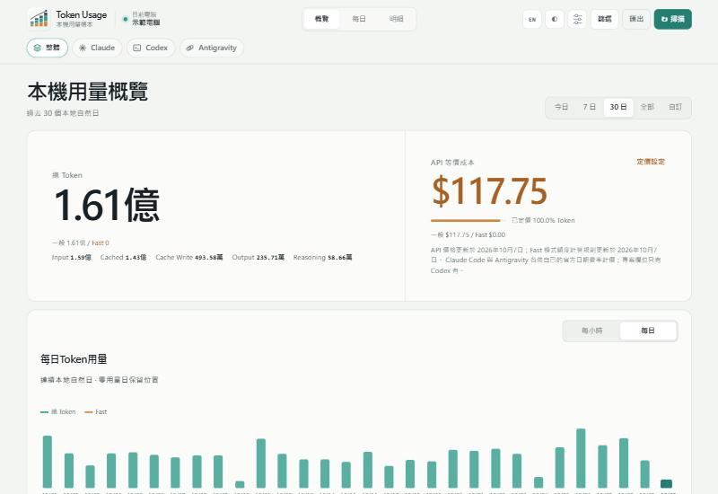
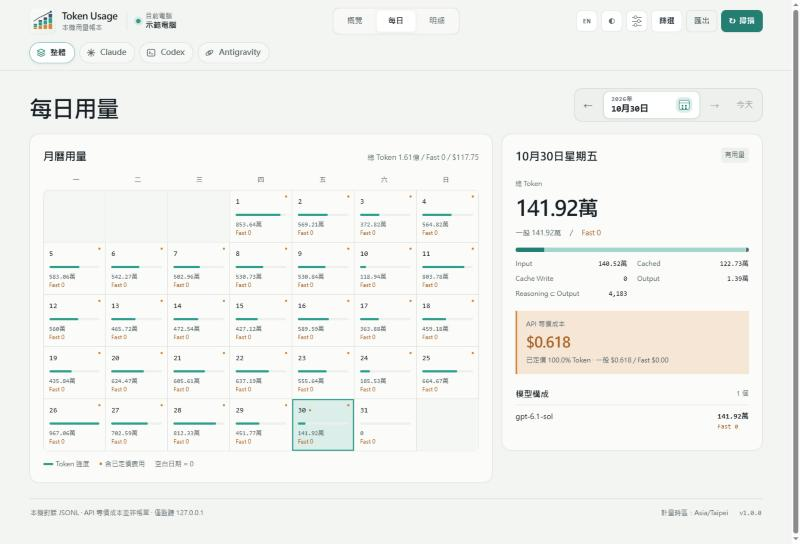

# Token Usage

**中文** | [English](README.en.md)

在自己的電腦上統計 **Codex**、**Claude Code** 與 **Antigravity** 的 Token 用量與 API 等價成本。三個來源合在同一個本機網頁裡，可以看整體，也可以切換到單一來源。所有資料只留在這台電腦。



## 功能

- **來源切換**：頁首一排圖示按鈕，可在「整體 · Claude · Codex · Antigravity」之間切換。選擇會記在瀏覽器，也可以用網址參數 `?provider=claude` 直接開啟。
- **概覽**：今日、7 日、30 日、全部，或精確到分鐘的自訂區間。顯示總 Token、Input／Cached／Cache Write／Output／Reasoning 拆分、API 等價成本與定價覆蓋率，以及每小時與每日趨勢。
- **每日**：月曆熱度、點選日期看當日模型構成與費用。
- **明細**：依模型、來源、Agent、專案、Thread 分組；對話列表與任務樹；搜尋對話。
- **匯出**：依目前來源與篩選匯出 CSV 或 JSON。
- **額度**：各工具的 5 小時與每週用量上限，依帳號顯示已用百分比、重置時間、過去各期的紀錄，以及每期的 Token 合計與 API 等價成本，見下方「額度」。
- **軟體更新**：自動檢查 GitHub 上的新版，有新版時在頁面上方提示；按下「下載並更新」會驗證、備份後替換程式並重新啟動，可攜版也能直接更新。
- 繁體中文／English、淺色／深色主題、字級與密度設定。



## 會統計什麼

| 來源 | 讀取的本機資料 | 記錄內容 |
|---|---|---|
| Codex | `CODEX_HOME`（預設 `~/.codex`）的 `sessions/`、`archived_sessions/` JSONL（含 Codex 壓縮後的 `.jsonl.zst`），以及 Codex 狀態資料庫的路徑與標題 | Token 分類、模型、來源、專案、Thread、Agent、Fast 模式 |
| Claude Code | `~/.claude/projects`、`~/.config/claude/projects` 下的 JSONL（含子代理與已同步到本機的 SSH 會話） | Token 分類、模型、5 分鐘／1 小時快取寫入、思考 Token、速度與推論地區 |
| Antigravity | `~/.gemini/antigravity*/brain/*/.system_generated/logs/transcript.jsonl` 與對應的 `conversations/*.db` | Token 分類、模型、思考 Token、模型選擇紀錄 |

**整體**就是三個來源相加。同一個模型若同時出現在 Claude Code 與 Antigravity（例如 `claude-opus-5-5`），在模型分組裡會合併成同一列。

不會保存回覆、思考內容或工具輸出。Claude Code 與 Antigravity 帳本只存 Token 計數、模型、時間與雜湊後的識別碼；Codex 另外保存 Codex 自己記錄的對話標題與專案路徑，而對話標題通常就是第一句提示詞。Antigravity 缺少原生計數時，會讀取文字計算字數來估算 Token，但同樣不保存內容。統計用量時不會讀取帳號憑證或真實帳單；「額度」頁會讀取哪些帳號資訊，見下方「額度」。

詳細的去重、歸屬與計價規則見 [計量與計價說明](docs/accounting.md)。

## 快速開始

### 1. 建置

需要 Go 1.26 以上。

```bash
go build -o token-usage.exe ./cmd/token-usage
```

或執行 `scripts/build.ps1`（Windows）／`scripts/build.sh`（Linux、macOS），會先跑完整測試，再輸出各平台執行檔到 `dist/`。

### 2. 決定資料放哪裡

在執行檔旁邊建立一個 `data` 資料夾，程式就會以**可攜模式**執行：三個帳本與額度紀錄都放在這個資料夾裡，程式和資料可以一起放進 OneDrive 等同步資料夾。沒有 `data` 資料夾時，資料放在使用者的應用程式資料夾（見下方「資料存在哪裡」）。

### 3. 安裝並啟動

```bash
token-usage install
```

安裝會先完整掃描一次 Codex 紀錄，設定登入時自動在背景啟動並立即啟動服務；服務啟動後會接著掃描 Claude Code 與 Antigravity。不需要系統管理員權限。可攜模式下程式留在原地執行；一般模式會把程式複製到使用者資料夾。

### 4. 開啟

```bash
token-usage
```

或直接開 **http://127.0.0.1:43189/**。

## 常用命令

```text
token-usage                         開啟網頁
token-usage summary --since 7d      近 7 日 Codex 摘要（可加 --json / --csv）
token-usage scan                    增量掃描三個來源
token-usage scan --rebuild          從現有 JSONL 重建 Codex 統計
token-usage serve                   在前景執行本機服務
token-usage doctor                  檢查 Codex 路徑、資料來源與服務狀態
token-usage config add-home PATH    加入額外的 CODEX_HOME
token-usage uninstall               停止服務、移除登入啟動（一般模式另刪程式），保留帳本
token-usage uninstall --purge       一般模式：另外刪除整個服務資料夾（三個帳本與額度紀錄）
```

背景服務啟動時會先掃描一次。之後 Codex 每 30 秒檢查檔案是否有變化，有變化才掃描，並每 10 分鐘保底掃描一次；Claude Code 與 Antigravity 每 10 分鐘掃描一次。網頁上的「掃描」按鈕會立即掃描三個來源。

## 解除安裝

安裝時不會把程式加進 `PATH`，所以請用程式的完整路徑執行。任何一份 `token-usage` 執行檔都可以，例如剛下載的那份；它會依當時的模式找到已安裝的服務。

### 一般模式

Windows（PowerShell）：

```powershell
& "$env:LOCALAPPDATA\Programs\token-usage\token-usage.exe" uninstall
```

macOS：

```bash
~/Library/Application\ Support/token-usage/bin/token-usage uninstall
```

Linux：

```bash
~/.local/bin/token-usage uninstall
```

這會停止服務、移除登入時自動啟動，並刪除安裝的程式；資料保留在服務資料夾（見「資料存在哪裡」）。連資料一起刪除時加上 `--purge`，會刪除整個服務資料夾，包括三個帳本、額度紀錄與設定，無法從工具內恢復。

### 可攜模式

```powershell
& "<程式所在資料夾>\token-usage.exe" uninstall
```

這只會停止服務並移除登入時自動啟動，程式與 `data` 資料夾都會保留，也不接受 `--purge`。要完全移除，接著自行刪除 `token-usage.exe` 與 `data` 資料夾；想保留用量紀錄的話，先把 `data` 複製到別處。

### 會刪除與保留什麼

| | 一般模式 | 一般模式加 `--purge` | 可攜模式 |
|---|---|---|---|
| 背景服務、登入時自動啟動 | 移除 | 移除 | 移除 |
| 程式 | 刪除 | 刪除 | 保留 |
| 帳本、額度紀錄與設定 | 保留 | 刪除 | 保留 |

## 資料存在哪裡

所有資料都在同一個服務資料夾裡：服務本身的檔案在最上層，每個帳本各有一個子資料夾。

```text
服務資料夾/
├─ config.json             設定
├─ daemon.log              服務紀錄
├─ token-usage-start.vbs   登入時啟動服務（Windows）
├─ backups/                軟體更新前的備份
├─ codex/                  Codex 統計（usage.sqlite）
├─ claude/                 Claude Code 帳本（usage.sqlite）
├─ antigravity/            Antigravity 帳本（usage.sqlite）
└─ limits/                 額度紀錄（limits.sqlite）
```

### 可攜模式（執行檔旁有 `data` 資料夾）

服務資料夾就是執行檔旁的 `data`：

```text
TokenUsage/
├─ token-usage.exe
└─ data/
```

放在 OneDrive 時請注意：

- 對 `data` 資料夾按右鍵選「一律保留在此裝置上」，避免檔案只留在雲端。
- 同一份 `data` 一次只讓一台電腦執行，不要兩台同時開著。
- 帳本是 SQLite 資料庫，執行中會有 `-wal`、`-shm` 附屬檔。雲端上的副本可能落後幾分鐘；要在另一台電腦使用時，先在原電腦停止服務，等同步完成再開。

### 一般模式

| 系統 | 程式 | 服務資料夾 |
|---|---|---|
| Windows | `%LOCALAPPDATA%\Programs\token-usage\token-usage.exe` | `%LOCALAPPDATA%\token-usage\` |
| macOS | `~/Library/Application Support/token-usage/bin/token-usage` | `~/Library/Application Support/token-usage/` |
| Linux | `~/.local/bin/token-usage` | `~/.local/share/token-usage/` |

三個帳本都是只增不刪：原始 JSONL 被清掉或移走之後，已經記錄的用量仍然保留。帳目若因來源修正而變動，舊值會留在帳本的修訂紀錄表中。

### 設定與環境變數

`config.json`：

```json
{
  "listen_address": "127.0.0.1",
  "port": 43189,
  "scan_interval_seconds": 600
}
```

| 變數 | 用途 |
|---|---|
| `CODEX_HOME` | Codex 資料夾（預設 `~/.codex`） |
| `TOKEN_USAGE_HOME` | 服務資料夾，必須是專用的空資料夾 |
| `TOKEN_USAGE_TIMEZONE` | 首次建立統計庫時使用的計量時區，例如 `Asia/Taipei` |
| `TOKEN_USAGE_LANG` | 命令列語言：`en` 或 `zh-TW` |
| `CLAUDE_CONFIG_DIR` | Claude Code 設定資料夾，可用逗號分隔多個 |
| `CLAUDE_TRACKER_DATA` | Claude Code 帳本資料夾 |
| `ANTIGRAVITY_TRACKER_HOME` | Antigravity 資料夾（預設 `~/.gemini`） |
| `ANTIGRAVITY_TRACKER_DATA` | Antigravity 帳本資料夾 |
| `LIMITS_TRACKER_DATA` | 額度紀錄資料夾 |

## 隱私與安全

- 服務只綁定 `127.0.0.1`，拒絕綁定其他位址；寫入類 API 會檢查來源必須是本機。
- 網頁不載入任何外部資源，有嚴格的 Content-Security-Policy。
- 不上傳任何用量資料、沒有遙測。
- 預設唯一會連網的是「軟體更新」：預設每 6 小時向 GitHub 查詢一次最新版本號（可在網頁頁尾的「軟體更新」關閉）。只有你按下「下載並更新」才會下載新版；下載後先比對發佈頁的 SHA256SUMS，備份程式、三個帳本與額度紀錄，再替換並重新啟動，新版沒有正常啟動就自動還原舊版。
- 只有在你開啟 Claude Code 額度後，才會連線到 Anthropic 官方端點查詢額度（見「額度」）；關閉時完全不會連線。
- Antigravity 額度只向本機 `127.0.0.1` 上 Antigravity 自己的語言伺服器查詢，不會連到外部。
- 價格表隨程式內建，執行時不會抓取網頁。

## 費用的意義

金額是依各家公開 **Standard API 價格**換算的等價成本，**不是**你的訂閱扣款或實際帳單：

- Codex 使用內建 OpenAI 價格表；明確標記為 Fast 的用量按 Codex 額度倍率折算。
- Claude Code 依 Anthropic 官方日期費率，區分 5 分鐘與 1 小時快取寫入；快速模式與美國推論地區按官方倍率。
- Antigravity 依各模型的日期費率，Gemini 3.1 Pro 長上下文使用較高費率。

沒有已核實費率的模型或日期會標為「未定價」，Token 照常統計，不會被當成零元。「定價設定」分成 Codex、Claude Code、Antigravity 三頁，各自列出內建費率與未定價的模型：Codex 模型可以指定別名或自訂單價，Claude Code 與 Antigravity 可以填入有生效日的自訂單價。

## 額度

「額度」頁顯示各工具的 5 小時與每週用量上限，依帳號列出已用百分比、重置時間、過去各期的紀錄，以及每一期的 Token 合計與 API 等價成本（計價方式與統計頁相同，並非帳單）。

- Codex 的 Token 與成本只計該帳號自己的用量：每次 Token 計數都和當下的額度快照寫在同一行，因此分得出是哪個帳號用的。
- 額度在週期結束前就被重置（官方重置或重置卡）時，舊週期截在實際重置的時間，標示「提前重置」，Token 與成本也只算到那時。
- 目前週期以各帳號最近一次讀到的額度為準：過了重置時間的額度以 0% 顯示，直到下一次讀數；之後的讀數不再有這個額度時才拿掉。不再使用的帳號可以按「移除」，從目前週期與「整體」的目前狀況拿掉，過去紀錄保留，之後讀到它的新額度時會自動回來。

選單一來源時，同一組模型的 5 小時與每週額度並排；選「整體」時是三個工具的使用率折線圖（1 天、7 天、30 天或自訂區間），下方列出各工具目前的狀況。5 小時與每週可以用按鈕切換。資料存在 `limits.sqlite`（位置見「資料存在哪裡」），軟體更新前會和帳本一起備份。

### 資料來源

- **Codex**（一律開啟）：讀取 Codex 在 rollout 紀錄（`sessions/`、`archived_sessions/`，含 `.jsonl.zst`）中隨每次 Token 計數寫下的 `rate_limits` 快照，包括已用百分比、週期長度（300 分鐘／10080 分鐘）、重置時間與方案，每分鐘收集一次。目前登入的帳號由各 Codex 資料夾中 Codex 自己的 `auth.json` 判斷，只取用其中的身分資訊（電子郵件、帳號 ID、方案），不取用也不保存任何權杖。
- **Claude Code**（預設關閉）：每 5 分鐘呼叫 Anthropic 官方額度端點 `https://api.anthropic.com/api/oauth/usage`（與 Claude Code 的 `/usage` 相同的資料），並向 `https://api.anthropic.com/api/oauth/profile` 取得帳號電子郵件與方案。這是整個 Claude 帳號的額度，聊天與 Claude Code 共用。額度項目照伺服器回傳的清單記錄，所以方案特有的額度（例如 Max 方案個別模型的每週額度）也會出現。
- **Antigravity**（一律開啟）：Antigravity 執行時，每 2 分鐘向 Antigravity 自己在本機的語言伺服器查詢帳號額度：每組模型（例如 Gemini、Claude 與 GPT、Gemini 4 Argon）各自的每週與 5 小時額度剩餘比例與重置時間，和 Antigravity 介面顯示的相同，以及帳號電子郵件與方案。程式透過 Antigravity 為自家 CLI 寫下的探索檔 `~/.gemini/antigravity/daemon/hub_*.json`（連接埠與本機 CSRF 權杖）找到伺服器，只連線到 `127.0.0.1`。較舊、沒有額度摘要的 Antigravity 只會回報目前卡住的那一個額度，這時週期長度依距離重置的時間推算。

### 開啟 Claude Code 額度

在「額度」頁開啟，或在服務的 `config.json` 加上 `"claude_usage_api": true`。開啟前，Claude Code 必須先在終端機登入過一次：

```bash
claude auth login
```

也可以在 Claude Code 裡輸入 `/login`。Claude 桌面應用程式的登入是分開的，不會被使用。

- 使用 Claude Code 存在 `~/.claude/.credentials.json`（或 `$CLAUDE_CONFIG_DIR/.credentials.json`）的登入。
- 存取權杖距離到期不到 10 分鐘，或請求回傳 401 時，會用與 Claude Code 相同的方式更新登入（`https://platform.claude.com/v1/oauth/token`，使用 Claude Code 的 OAuth client ID），再把新權杖以原子寫入寫回同一個檔案，其他欄位保持不變。
- 更新權杖本身約 30 天後到期，到期後請重新登入。
- 因為程式會輪替更新權杖，若終端機裡的 Claude Code 剛好在同一刻也更新登入，那邊可能需要重新登入（很少發生）。
- 權杖只會送往上述 Anthropic 端點，程式不會記錄或另外保存。
- macOS 把登入存在鑰匙圈，目前不支援。

**關閉**：在「額度」頁關閉，或把 `claude_usage_api` 改回 `false`。關閉後不再呼叫 Anthropic 端點，也不再讀寫登入檔；除此之外沒有任何功能會碰到這個檔案。

### 限制

- 帳號名稱只能從開始追蹤的那一刻起取得。在那之前的 Codex 紀錄仍依方案與每週重置時間分成不同帳號，顯示為「未辨識」加上方案名稱的帳號，不會出現在「目前」；之後該帳號用到同一個週期時，這段紀錄會自動改歸給它。
- 服務沒有執行時切換了 Codex 帳號，這段期間的讀數會歸到最後看到的帳號。
- Antigravity 只有在執行中才會記錄，關閉期間沒有資料。
- Token 合計是該工具在這段期間的全部用量，不依帳號拆分。

## 已知限制

- 只統計這台電腦上的紀錄；其他電腦的用量要在那台電腦上看。
- 原始紀錄在安裝前就已刪除的部分，無法補回。
- 只有 Codex 的紀錄含專案與對話標題；Claude Code 與 Antigravity 的對話以「來源 · ID 前 8 碼」顯示。
- `summary` 命令目前只輸出 Codex 的摘要，三個來源合計請看網頁或匯出。

## 開發與測試

```bash
go test ./...
go vet ./...
```

網頁原始檔在 `internal/web/static/`，建置時會嵌入執行檔。

## 來源與授權

本專案修改自 zJay 的 [token-usage](https://github.com/zJay26/token-usage)。

以 GNU 通用公共授權條款第 3 版（GPLv3）發布，見 [LICENSE](LICENSE)；上游專案的 MIT 授權聲明與相依套件授權見 [THIRD_PARTY_NOTICES.md](THIRD_PARTY_NOTICES.md)。
